# Phase 1 — Reference Comparison Board

This repository board links the exact approved source sheets used for the visual design lock. Rendered presentation boards are also supplied at the conversation checkpoint.

## Turnaround and build pose

| A-pose | Front | Side | Back |
|---|---|---|---|
| 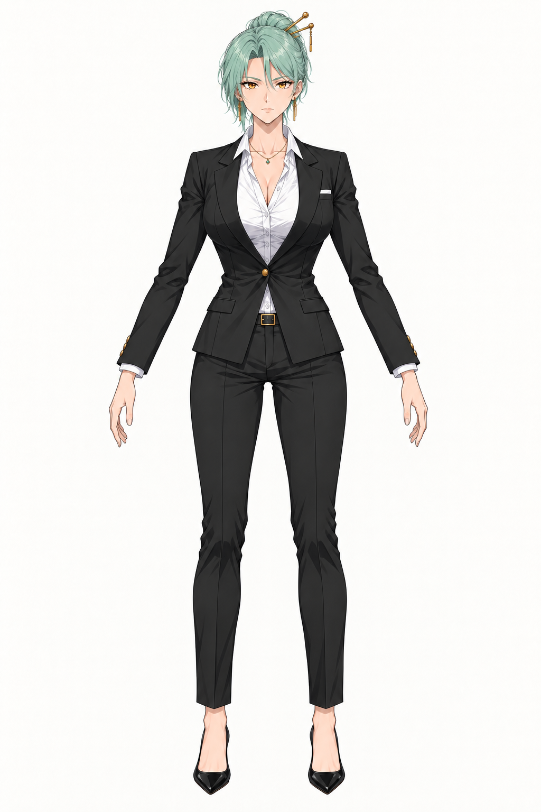 | 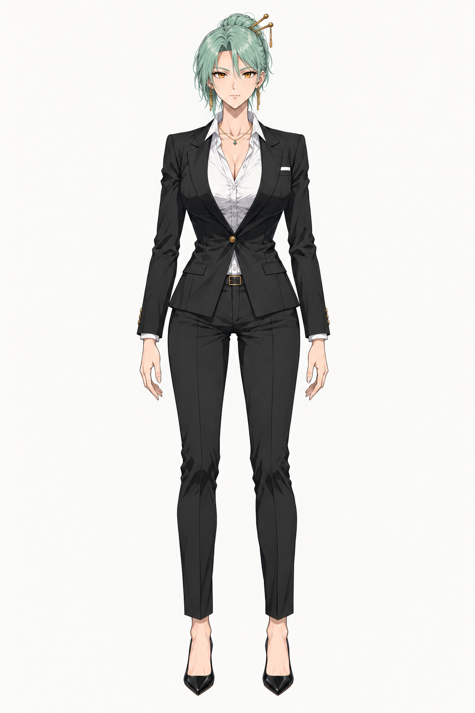 | 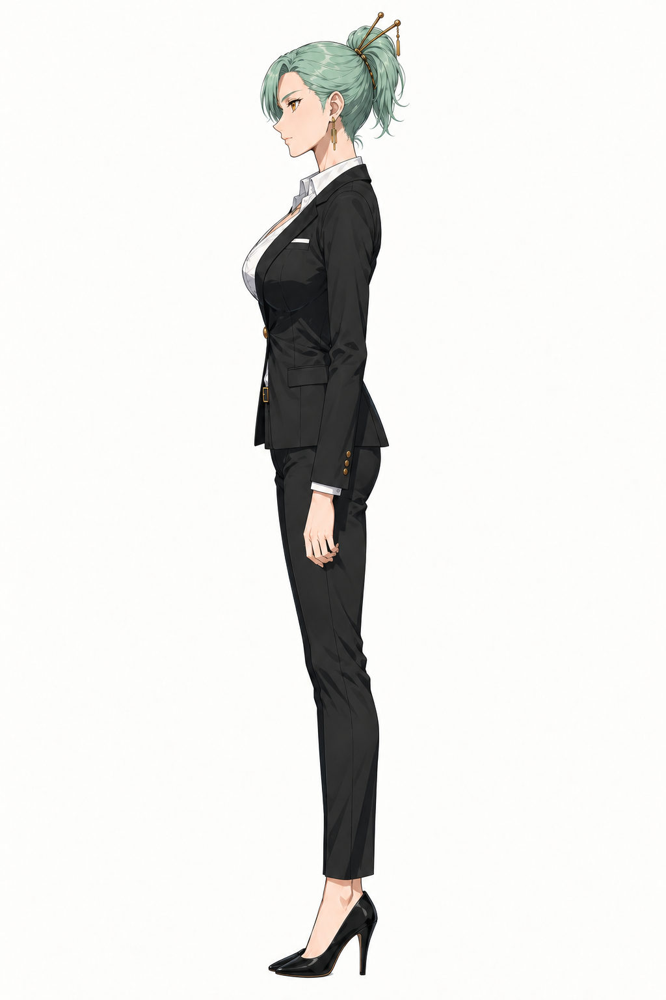 | 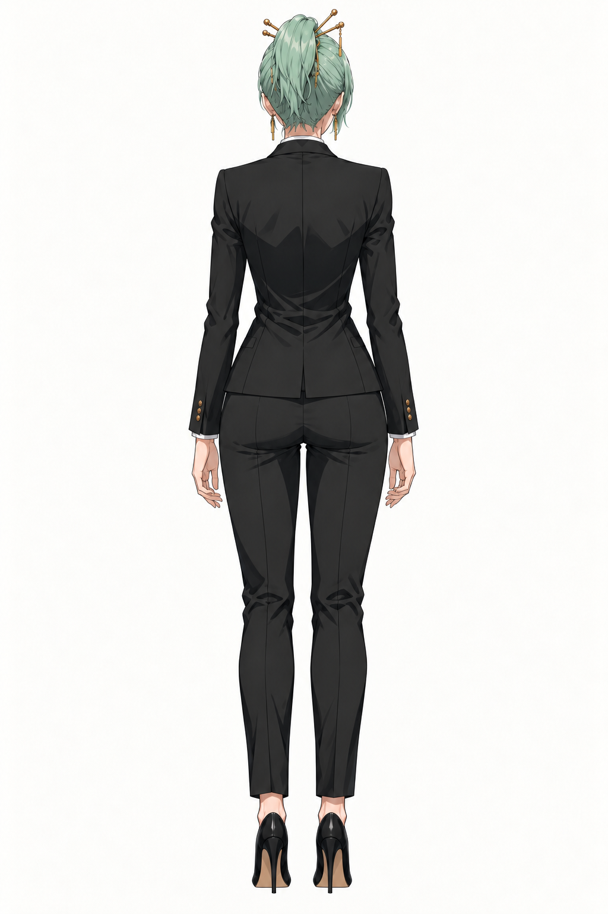 |

## Identity and construction

| System | Governing reference | Checkpoint purpose |
|---|---|---|
| Neutral identity | 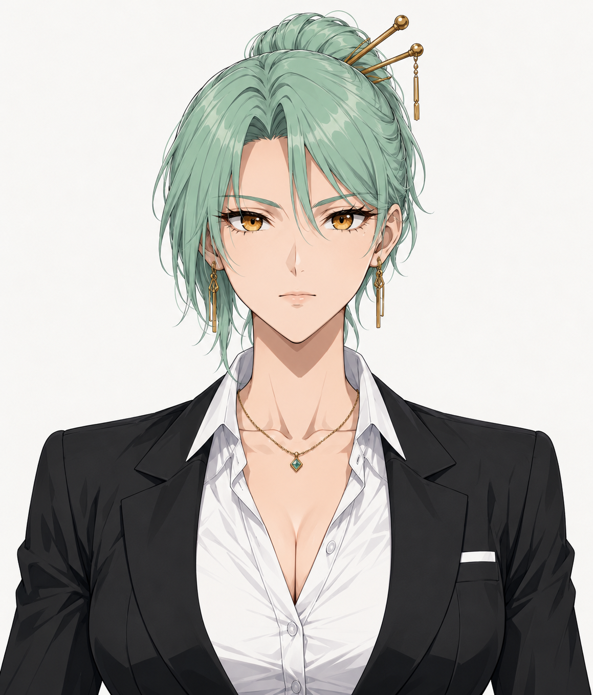 | Face, fringe asymmetry, eyes, jewelry, blouse, and blazer identity |
| Hair | 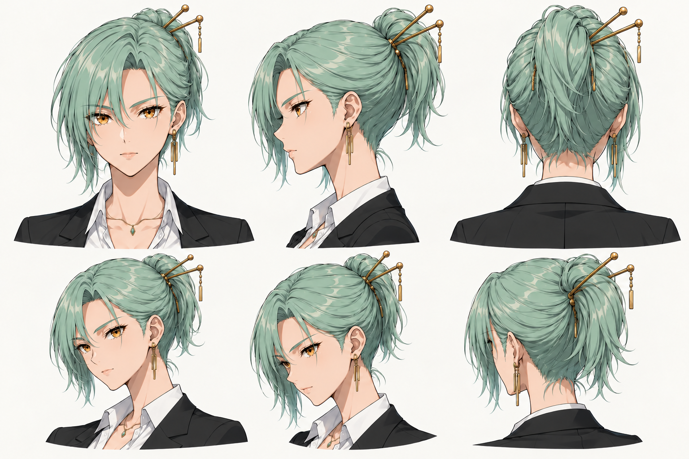 | High bun-loop, short ponytail fan, nape, and loose strands |
| Eyes | 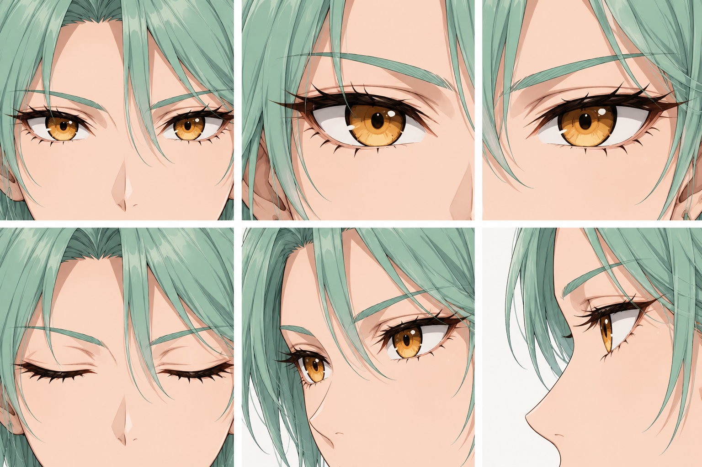 | Almond shape, iris, lashes, and full eyelid closure |
| Mouth | 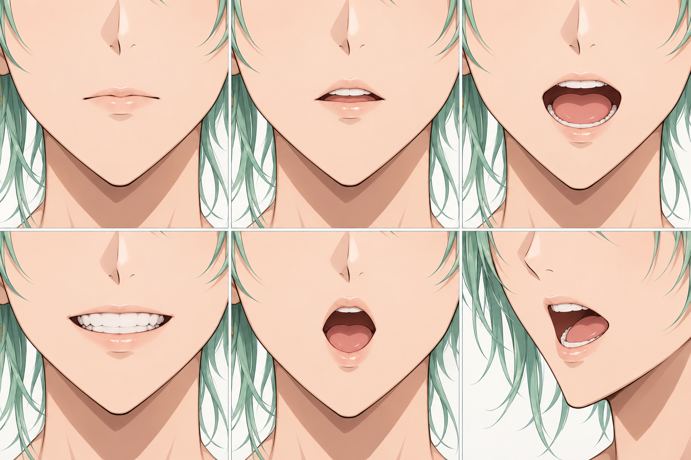 | Lip sealing, mouth cavity, teeth, and tongue |
| Accessories | 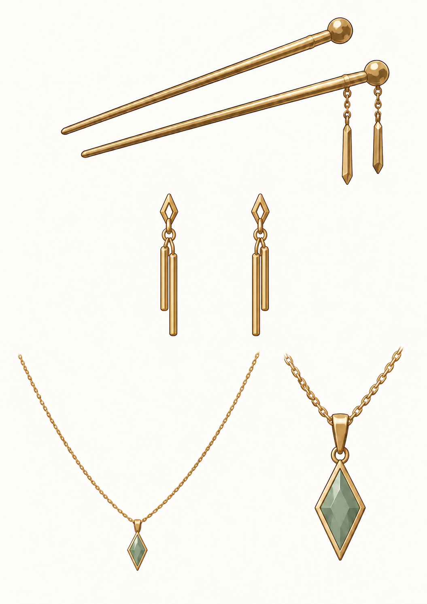 | Rigid gold pieces and separately moving chains |
| Outfit | 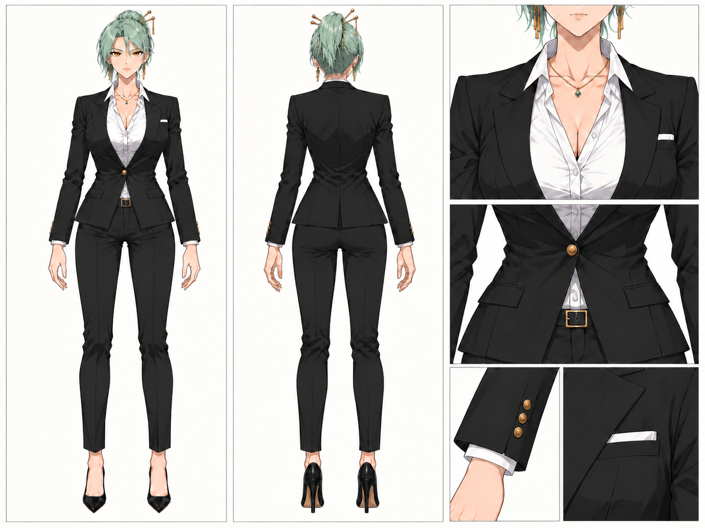 | Single-button blazer, lapels, pockets, cuffs, and blouse |
| Hands and pumps | 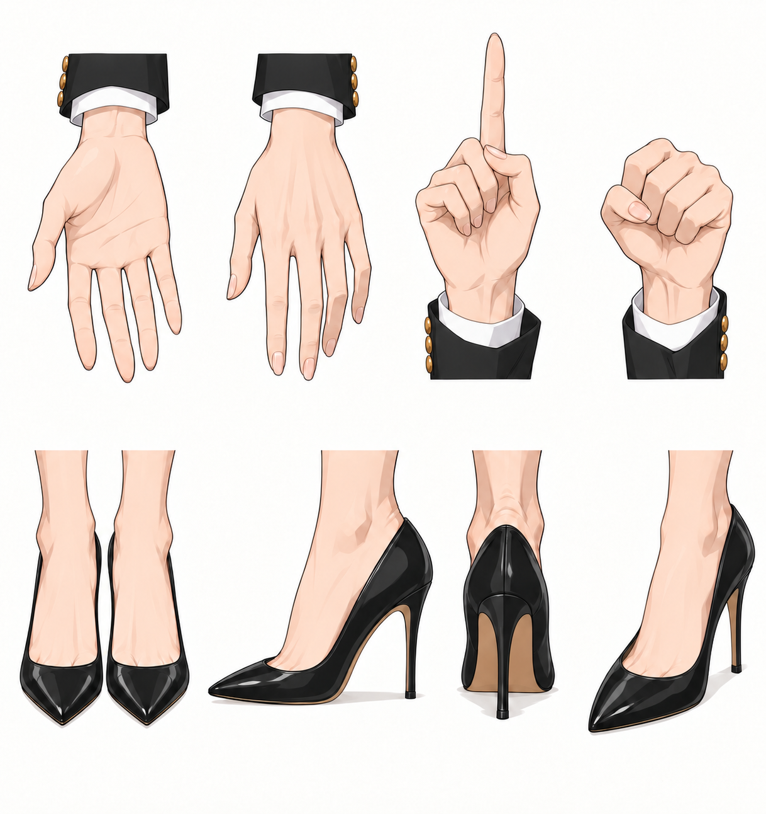 | Finger articulation and footwear construction |

These are visual references, not measured orthographic geometry or animation frames.
